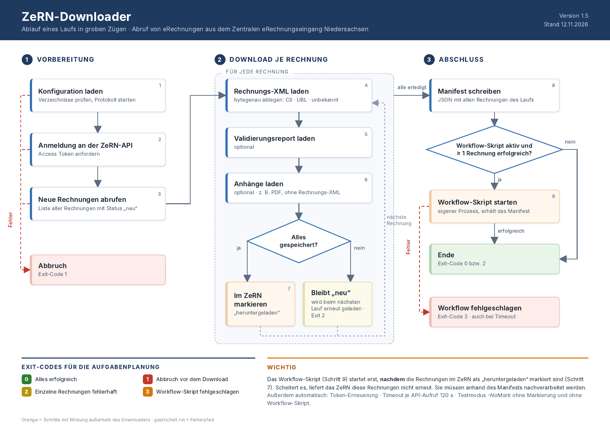

# ZeRN-Downloader
Powershell-Skript zum automatisierten Herunterladen von eRechnungen (XRechnung) aus dem ZeRN (Zentraler eRechnungseingang Niedersachsen) per REST-API.

Das Skript ist darauf ausgelegt, auf einem Windows-Server per Aufgabenplaner regelmäßig (z.B. einmal pro Stunde) ausgeführt zu werden. Die eRechnungsdateien werden aus dem ZeRN-Portal heruntergeladen und anschließend als "heruntergeladen" markiert.

Lauffähig mit Windows PowerShell 5.1 und PowerShell 7.

## Ablauf


## Voraussetzungen
Um mit dem Skript eRechnungen aus dem ZeRN-Portal abrufen zu können, muss die API-Schnittstelle für das gewünschte Benutzerkonto vom Land freigeschaltet worden sein. 

Informationen zur Schnittstelle und deren Freischaltung gibt es [hier](https://rechnung.niedersachsen.de/startseite/informationen-fuer-rechnungsempfaenger/schnittstelle-zum-abruf-von-rechnungen-210483.html).

## Installation und Konfiguration
Alle Dateien müssen in ein Arbeitsverzeichnis kopiert werden, z.B. `C:\ZeRN`.

Im Arbeitsverzeichnis muss eine Konfigurationsdatei `ZeRN-Downloader.config.ps1` angelegt werden. Als Vorlage durch Umbenennen kann hierfür die Datei `ZeRN-Downloader.config-sample.ps1` aus dem Repository verwendet werden.

Die Vorlage ist kommentiert und in Abschnitte gegliedert: Zugangsdaten, Verzeichnisse, Protokollierung und Workflow-Skript. Pflicht sind Benutzername und Passwort, alle anderen Werte haben sinnvolle Vorgaben.

**Wichtig:** Die Konfigurationsdatei als **UTF-8 mit BOM** speichern (Notepad: "UTF-8 mit BOM"). Sonst liest Windows PowerShell 5.1 Umlaute falsch, was vor allem beim Passwort zu einer fehlgeschlagenen Anmeldung führt. Enthält das Passwort `$` oder `` ` ``, muss es in einfachen Anführungszeichen stehen.

| Parameter | Pflicht | Standard | Bedeutung |
|---|---|---|---|
| `$api_username` | ja | | Benutzername der API |
| `$api_password` | ja | | Passwort der API |
| `$api_timeout` | | `120` | Timeout je API-Aufruf in Sekunden |
| `$files_xml` | ja | | Rechnungen mit nicht erkannter Syntax |
| `$files_xml_cii` | ja | | Rechnungen in CII-Syntax |
| `$files_xml_ubl` | ja | | Rechnungen in UBL-Syntax (Invoice, CreditNote) |
| `$files_validation` | | `""` | Validierungsreports, leer = nicht laden |
| `$files_attachment` | | `""` | Anhänge, leer = nicht laden |
| `$files_log` | ja | | Protokolldateien |
| `$files_manifest` | | `<files_log>\manifest` | Manifeste der Läufe |
| `$log_level` | | `$log_info` | `$log_debug`, `$log_info`, `$log_warning`, `$log_error` |
| `$workflowscript` | | `""` | Workflow-Skript, leer = keines |
| `$workflow_timeout` | | `3600` | Maximale Laufzeit des Workflow-Skripts in Sekunden, 0 = unbegrenzt |

Nicht vorhandene Verzeichnisse werden beim Start angelegt.

## Einrichtung in der Aufgabenplanung
Programm: `powershell.exe`

Argumente: `-NoProfile -ExecutionPolicy Bypass -File "C:\ZeRN\ZeRN-Downloader.ps1"`

Für einen ersten Probelauf kann das Skript mit `-NoMark` gestartet werden: Rechnungen, Reports und Anhänge werden geladen, im ZeRN aber nicht als "heruntergeladen" markiert.

Wichtig ist `-File` (nicht `-Command`), damit der Exit-Code in der Aufgabenplanung als "Ergebnis der letzten Ausführung" ankommt.

| Exit-Code | Bedeutung |
|---|---|
| 0 | Alles erfolgreich |
| 1 | Abbruch: Konfiguration fehlt, Verzeichnis nicht anlegbar, Anmeldung oder Rechnungsliste fehlgeschlagen |
| 2 | Mindestens eine Rechnung fehlerhaft. Diese wird nicht als "heruntergeladen" markiert und beim nächsten Lauf erneut geladen |
| 3 | Workflow-Skript fehlgeschlagen (nicht gefunden, Exit-Code ungleich 0 oder Timeout). Die Rechnungen sind trotzdem als "heruntergeladen" markiert |

## Workflow-Skript
Optional kann in der Konfiguration ein PowerShell-Skript angegeben werden, das nach dem Download startet, z.B. für den Import in ein DMS:

```powershell
$workflowscript = "$PSScriptRoot\ZeRN-Workflow.ps1"
```

- Es startet nur, wenn im Lauf **mindestens eine Rechnung vollständig gespeichert** wurde, also nicht bei 0 neuen Rechnungen, nicht nach einem Abbruch (Exit-Code 1) und nicht im Testmodus `-NoMark`.
- Es läuft in einem **eigenen PowerShell-Prozess** (gleiche PowerShell-Version wie der Downloader). Es hat keinen Zugriff auf die Variablen des Downloaders, auch nicht auf das Passwort. Der Downloader wartet auf das Ende.
- Aufruf: `-File <Skript> -ExitCode <Download-Exit-Code> -ManifestPath <Pfad zur JSON-Datei>`. Hat das Skript einen `param()`-Block, muss es diese beiden Parameter deklarieren.
- Ausgaben des Skripts (Standardausgabe und Fehler) werden ins Protokoll des Downloaders übernommen.
- Exit-Code ungleich 0, Timeout oder fehlende Datei führen zu Exit-Code 3 des Downloaders.

Vorlage: `ZeRN-Workflow-sample.ps1`.

### Manifest
Für jeden Lauf mit Rechnungen wird ein Manifest geschrieben (auch ohne Workflow-Skript), standardmäßig unter `log\manifest\<Datum>_<Uhrzeit>.json` (konfigurierbar über `$files_manifest`). Es enthält je Rechnung:

`InvoiceId`, `Received`, `SenderName`, `SenderEmail`, `SenderInvoiceNumber`, `Scheme` (1 = UBL, 2 = CII), `TypeCode` (z.B. 380 Rechnung, 381 Gutschrift), `Syntax`, `XmlFile`, `ValidationFile`, `Attachments` (je `AttachmentId`, `FileName`, `MimeType`, `File`), `Marked` und `Success`.

**Das Workflow-Skript sollte nur Rechnungen mit `Success = true` verarbeiten.** Fehlerhafte Rechnungen bleiben im ZeRN auf "neu", werden beim nächsten Lauf erneut geladen und tauchen dann im nächsten Manifest wieder auf.

## Verhalten
- **Rechnungs-XML** wird bytegenau so gespeichert, wie das ZeRN sie liefert (keine Umformatierung, keine BOM). Die Einordnung nach CII/UBL erfolgt anhand des XML-Namespaces; UBL-Gutschriften (CreditNote) landen im UBL-Verzeichnis.
- **Validierungsreport** (KoSIT) wird ebenfalls bytegenau als `<Rechnungs-ID>.xml` gespeichert.
- **Anhänge** werden als `<Rechnungs-ID>-attachment-<Dateiname>` gespeichert. Die Originalrechnung, die das ZeRN zusätzlich als XML-Anhang führt, wird dabei übersprungen, da sie bereits im XML-Verzeichnis liegt. Dateinamen werden bereinigt (keine Pfadanteile, keine ungültigen Zeichen).
- Dateien werden zunächst als `.part` geschrieben und erst danach umbenannt. Nachgelagerte Prozesse, die die Verzeichnisse überwachen, sehen so nie halbfertige Dateien.
- Das Access Token wird bei Ablauf automatisch per Refresh Token erneuert; bei HTTP 401 wird der Aufruf einmalig mit neuem Token wiederholt.
- Eine Rechnung wird nur dann als "heruntergeladen" markiert, wenn Rechnung, Validierungsreport und alle Anhänge erfolgreich gespeichert wurden.
